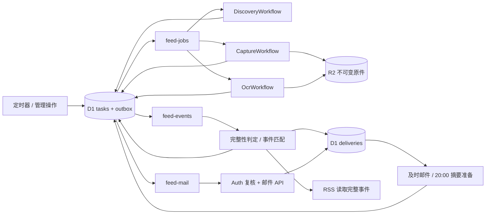

# Queue 与 Workflow 执行设计

状态：2026-10-12 技术设计稿。与[数据库设计](database.md)、[Auth 契约](auth-contract.md)配套；不含部署配置或已购买套餐。

## 选择：三条业务 Queue，三个 Workflow

使用同一代码库、一个 Cloudflare Worker 部署单元，包含 HTTP、scheduled、queue 入口及三个 Workflow 类。按职责分模块，暂不拆自建微服务。每条业务 Queue 配自己的 DLQ，合计三条业务队列和三条死信队列。

| 组件 | 做什么 | 成功/确认边界 |
| --- | --- | --- |
| `feed-jobs` Queue | 把已持久化任务交给对应 Workflow | 指定实例已创建或已确认存在，并记下接手事实；不是采集完成 |
| `DiscoveryWorkflow` | 一个栏目的一次 live 检查或一个有限 backfill 分页批次 | 页面结果、游标和新任务提交成功 |
| `CaptureWorkflow` | 一篇通知的一次原文/附件采集及版本组装 | 原件清单、缺项与 OCR 任务持久化；无需等待 OCR |
| `OcrWorkflow` | 一个输入对象与处理版本的一次文字识别 | 派生结果保存，相关 requirement 满足，发起重新判定 |
| `feed-events` Queue | 版本完整性判定、内容事件分批匹配 | 对应条件更新和 outbox/游标成功提交 |
| `feed-mail` Queue | 发送一封已经固定内容的邮件 | 保存服务商受理结果，或持久化延期/结果不明等可恢复状态 |

第三条事件 Queue 用于把“抓完”与“有多少用户订阅”隔开。新增订阅人数只增加匹配/邮件工作，不延长抓取 Workflow；事件匹配失败也不要求重抓文章。完整性判定和每批匹配都是短数据库操作，无需为每个订阅创建 Workflow。



R2、D1、Queue 都有各自提交边界；图中的箭头不能当成跨服务事务。RSS 请求只查完整事件及权限，不启动 Workflow。

## 消息格式与稳定身份

消息只传小型 ID，不带正文、附件字节、邮箱、Auth secret 或 RSS token。`outboxId` 用于诊断；去重依据业务 ID 和数据库状态，不能只看 Queue 的投递次数。

```ts
type StartJob = {
  v: 1; type: "start-job"; outboxId: string;
  taskId: string; attempt: number;
};
type ContentMessage =
  | { v: 1; type: "check-ready"; outboxId: string; revisionId: string; generation?: number; sourceTaskId?: string }
  | { v: 1; type: "event-ready"; outboxId: string; eventId: string; revisionId: string }
  | { v: 1; type: "source-associated"; outboxId: string; articleId: string; sourceId: string; discoveryTaskId: string; afterEventId: string }
  | { v: 1; type: "match-source"; outboxId: string; taskId: string; eventId: string; sourceId: string; generation: number; page: number };
type SendMail = {
  v: 1; type: "send-mail"; outboxId: string; messageId: string;
};
```

消费者严格验证类型、版本和字段大小，再从 D1 读取权威内容；未知 schema 进入死信/诊断，不能猜测执行。任务 payload 由生产方保存，不能因为消息写了某个 URL 就直接访问。

栏目关联提交在原发现任务的 attempt 条件下写入 `source-associated` outbox；消费者从已保存的 `article_sources` 分页补齐事件来源与匹配任务。版本就绪事务也读取提交时的来源关联，覆盖两个事务任意先后顺序。不得用下一次抓取的日期/首次发现时间覆盖已有证据。

| 身份 | 建议组成 | 何时变更 |
| --- | --- | --- |
| 栏目发现 task key | `discover:<source>:<configVersion>:<scheduledSlot>` | 新一轮检查；重试同轮不变 |
| 历史补抓 task key | `backfill:<source>:<runId>:<cursorHash>` | 下一有界分页批次 |
| 采集 task key | `capture:<article>:<observationIntentId>` | 新复查或显式重抓；不按 URL 永久去重 |
| OCR task key | `ocr:<inputHash>:<processorVersion>:<optionsHash>` | 输入、处理器或选项改变；相同输入跨版本复用 |
| Workflow instance id | `task-<taskId>-a<attemptNo>` | 仅终止实例后的显式恢复增加 attempt；Queue 重投保持不变 |
| 完整性检查 outbox key | `ready:<revisionId>:<requirementGeneration>` | 必需项状态发生实际进展，允许再次判定 |
| 内容事件 id | 持久化事件 ID，revision 唯一 | 只有新且需呈现的版本；OCR 重跑不变 |
| 匹配 task key | `match:<eventId>:<sourceId>:<associationGeneration>` | 新来源关联或已审计日期核实；分页只推进 checkpoint |
| 邮件幂等键 | `feed-mail/<messageId>` | 尚未提交的邮件取消后可新建；重试不变 |

实例 ID 字符/长度按平台约束编码或 hash，不能直接拼接长 URL；数据库保留业务 key 的原值。实例已结束也不复用同一 ID 创建下一轮。[Workflows API](https://developers.cloudflare.com/workflows/build/workers-api/)

## 三个 Workflow 的步骤

### DiscoveryWorkflow

1. 读取任务、固定的 source 配置版本、live/backfill 分类及边界；检查暂停/取消。
2. `step.do` 获取一页列表，将原始结果存 R2；返回对象引用和页面摘要。
3. 解析、校验 canonical URL 与日期精度；一个有限页面批次中，写 article/source 关联、唯一 capture task、outbox 和分页 checkpoint。
4. 达到本次页数/运行时长预算就结束当前批次，把下一游标作为后续任务保存；全部完成时记成功及下次检查时间。

一个 Workflow 不扫描整站历史，也不顺序等待所有文章采集。live 刷新和 backfill 分别使用调度预算；先安排到期 live，再在剩余预算内补历史。Queue 不承担业务优先级保证；若未来需要严格隔离历史流量，再按测量结果拆队列，首版不预先建立复杂调度器。

列表外链和跳转必须服从 source allowlist；沿用 MVP 的 origin、桥接签名、时效和文件校验。源站暂时失联不等于通知已删除。

### CaptureWorkflow

1. 获取文章短租约并递增 fencing token，固定 source adapter 与任务上下文；已有同任务结果直接复用。其他有效采集持有者存在时延期，不忙等。
2. `step.do` 执行一个可独立重建的源站浏览器会话：处理验证、取得正文/清单、抓取该会话才能取得的附件、保存原貌；上传不可变对象，返回清单引用。**不能把“通过验证码”和“下载受该会话保护的文件”拆成两个假定会话永存的步骤。**
3. 校验类型/大小/hash，登记观测和版本，冻结预期 requirement；相邻观测相同则不新建版本。已保存文件可复用，失败项有明确错误。租约续期/最终提交检查 fence，过期执行者不能写入当前版本关系。
4. 需要正文 PDF OCR 时创建唯一 OCR task 与 outbox；无必要 OCR 时直接生成 check-ready。所有完成/缺项状态都落 D1，任务结束不等于版本 ready。

相同任务的重放必须找到相同 capture 结果，不能再递增版本号。付费调用发生在持久步骤内，优先复用已登记的远端 job/result；但网络在服务商受理后中断时，仍可能无法证明是否已扣费，需记录 `external_outcome_unknown`，不承诺第三方计费 exactly-once。

### OcrWorkflow

1. 校验输入对象 hash、正文角色、处理器版本和必要性；命中已有成功派生结果就复用。
2. 有限步骤处理分块/分页，保存每个成功输出与进度；OCR 页数/费用预算与抓取调用预算分别记录。
3. 聚合并校验完整结果，写 `derived_outputs`；满足引用该输入的对应版本 requirement，并各产生一个 check-ready outbox。

只重做 OCR 时创建新派生结果和阅读投影，保留原引用，不创建源版本/更新事件。旧版本 OCR 晚到可以补全旧版，但不能将当前阅读版本指针向后移动。

`CaptureWorkflow` 不等待子 OCR Workflow 结束；通过 D1 requirement 汇合。这样无需在一个父 Workflow 里长期持有“等所有附件/OCR”的内存状态，也不依赖可能丢失或晚到的临时回调。[Workflows 持久步骤规则](https://developers.cloudflare.com/workflows/build/rules-of-workflows/)

## feed-events：就绪判定与分批匹配

check-ready 读取指定 revision：已经 ready 就幂等结束；缺项则记录摘要并结束，等待实际进展产生新 generation，不能把“尚未完成”当失败无限重试。条件满足时，以 D1 条件写入同时完成 ready、唯一 event、event_sources 及匹配 outbox；presentation_only 版本可归档但不制造更新事件。

每个 match task 固定 event/source，使用 `(subscription_id,target_id)` keyset cursor。每页读取当前候选，按 target 生效时间、日期、历史分类和变更时间决定资格；同一用户重复命中只生成一条 delivery。提交 match/delivery/checkpoint 后再确认消息；仍有下一页则同事务创建下一页 outbox。重试从已提交游标继续，不能先推进游标再写匹配结果。

新建订阅时间必须来自服务端。分页期间新建或后来新增栏目目标不能被人为回填早于当前时间；因此低于游标的新目标没有丢失旧邮件资格。恢复/编辑旧订阅另有 reconciliation 任务，对未处理候选按资格重评，不依赖重复扫描所有历史用户。

## feed-mail：准备和发送分开

及时准备器在匹配产生候选后运行；摘要准备器每天北京时间 20:00 固定窗口。二者都通过同一 delivery CAS 占用、持久化收件人/内容快照和 message id，再写 send-mail outbox。一个用户多个摘要订阅合成一封，没有候选不建邮件。

发送器只接受 `messageId`：

1. 已受理/已送达/永久取消就确认消息；未到 next_attempt_at 则持久延期。
2. 请求 Auth 的 Feed 专用权益/已验证邮箱，重查订阅仍有效、邮件偏好及抑制记录。Auth 故障延期；明确无权/邮箱未验证暂停。未提交消息发现资格或收件人改变则取消并重新准备，不能修改已提交快照。
3. 条件占用 message，持久化 `submitting`，用固定 idempotency_key 提交固定内容；保存 provider id、受理事实或错误。
4. 网络结果不明保存 `submission_unknown`，通过服务商查询/webhook，或在其有效幂等窗口内用完全相同请求对账。超出窗口仍无法确认时转人工处理，不能因为 Queue 重试就发第二封。

可以在“已持久化延期/结果不明”后 ack，前提是定时恢复器确实扫描这些状态；未能保存状态则必须 retry。Queue 消费超时后，后继不能直接夺取邮件租约重发，要先判断之前是否可能提交。

服务商 webhook 验签后先写唯一 receipt，再返回成功，异步应用状态。`email.sent/accepted`、收件服务器接收和用户阅读是不同事实。若选 Resend，其幂等键文档给出 24 小时窗口；数据库投递账本需保留更久，不能把服务商窗口当永久去重。[Resend 幂等说明](https://resend.com/docs/dashboard/emails/idempotency-keys) / [事件类型](https://resend.com/docs/webhooks/event-types)

## 交接、重试与恢复

task 状态为 `queued → starting → running → succeeded`，异常可到 `retry_wait / blocked / failed / cancelled`。`retry_wait` 有 due_at；`blocked` 等待外部条件；`failed` 表示达到有界重试上限、可人工恢复。文章版本状态和邮件状态另行维护，不复用 task.state 表示业务成功。

Queue 启动器读取 task 与 attempt，调用指定 instance ID 的 create。超时/实例已存在时查询同 ID，确认接手后才 ack。若 create 成功但数据库记账失败，重投查询同 ID 恢复；不要换随机 ID。终止实例只有在确认 terminal 后才由恢复操作递增 attempt；正在 sleep/running 的实例不能因本地短租约到期就复制一份。

| 故障 | 负责处理的层 | 行为 |
| --- | --- | --- |
| Queue→Workflow 交接短暂失败 | Queue | 有界重投，同实例 ID；超过上限去该 Queue 的 DLQ |
| Firecrawl 429 | 抓取 Workflow | 尊重 Retry-After，否则指数退避＋抖动；持久 sleep / retry_wait；有尝试次数和总时长上限 |
| 402、余额或业务预算耗尽 | 任务调度 | blocked + 原因 + 下次复核；禁止快速循环调用付费 API |
| 网络超时 / 5xx | 对应 Workflow 步骤 | 有界重试，复用已保存产物；先辨明是否为结果不明的付费副作用 |
| 正文解析错误、验证码伪文件、缺附件 | 采集/完整性模块 | 保存证据与缺项；失败源不影响其他通知，不发布部分版本 |
| OCR 失败 | OCR Workflow | 只重试该输入/处理步骤，不重跑列表或已成功附件 |
| Auth 暂不可用 | 权益适配器 / 发送器 | 输出暂不可用、发送延期；不删除订阅，不解释为无限或永久撤权 |
| 邮件永久退信/投诉 | 邮件模块 | 抑制对应收件地址，保留订阅和历史记录 |
| Workflow 运行后失败 | task 恢复器 | D1 记录失败与明确恢复入口；**不会自动出现在原启动 Queue 的 DLQ** |

每个外部调用仅由一个层负责自动重试：关闭 SDK 隐式重试或纳入同一预算，避免 Queue × Workflow × SDK 三层相乘。具体尝试次数、退避上限和费用上限由上线配置确定；每个策略必须是有界值，不能留无限重试。

无需自建全局并发器、每源信号量或一个集中 Durable Object。Cloudflare 和 Firecrawl 自身并行；文章租约保护写入一致性，API 429 保护失败恢复。Queue 的 `max_concurrency` 只限制消费者调用，启动 Workflow 后不能代表实际抓取并发。[Queue 并发说明](https://developers.cloudflare.com/queues/configuration/consumer-concurrency/)；Firecrawl 的代理不会取消账号 API/并发上限。[Firecrawl 错误说明](https://github.com/firecrawl/firecrawl-docs/blob/main/api-reference/errors.mdx)

定时入口按 due_at 做小批工作：安排到期来源/文章复查、派发 outbox、唤醒 retry_wait、核对 starting/running 的异常任务、补做未完成事件匹配和邮件准备、推进20:00摘要。所有扫描用索引＋keyset 游标；优先级和历史预算在入队前执行，不假定队列替业务排序。

恢复器还要处理：数据库已提交但未发 Queue；Queue 发送成功而未标 outbox；队列留存到期/DLQ；任务已结束但最终数据库更新失败；OCR 已完成却未满足 requirement；事件已 ready 但尚未匹配。D1 是可重放的依据，不能依赖 Queue 留存永远保存工作。[至少一次投递](https://developers.cloudflare.com/queues/reference/delivery-guarantees/) / [死信队列](https://developers.cloudflare.com/queues/configuration/dead-letter-queues/)

## 代码 Module 与 Interface

| Module | 建议 Interface | Implementation 内部承担 |
| --- | --- | --- |
| `Sources` | `scheduleDue`, `discover` | 各站点列表/分页、历史窗口、任务提交 |
| `Archive` | `capture`, `extract`, `reconcileRevision`, `readRevision` | 会话、fence、不可变原件、完整性与唯一事件 |
| `Subscriptions` | `change`, `list`, `readRss` | 冻结栏目、配置与运行数量、权限和凭证轮换 |
| `Notifications` | `match`, `prepare`, `deliver` | 时间资格、投递占用、摘要、发信前校验及结果不明恢复 |
| `TaskRuntime` | 任务交接、outbox 分发与恢复入口 | 稳定 ID、持久步骤与接手确认；不作业务就绪判断 |
| `authClient` | `getPolicy`, `getRecipient` | 业务调用者不传 secret；Adapter 隐藏 RPC envelope 和故障分类 |

Queue 和 Workflow 类作为薄 Adapter；业务幂等和状态推进放在对应 Module，管理员手动重试调用相同 Interface。业务 Interface 不暴露 Cloudflare message 对象，站点 Adapter 不直接写用户邮件表。完整的调用不变量、Seam 放置与测试方式见 [Module 设计](modules.md)。

## 上线观察项

按 source/task/revision/event/message 串起 trace，记录最老 queued/outbox 年龄、发现→ready 延迟、缺项数量、429/402、付费调用与 OCR 页数、DLQ 数量、Auth unavailable、邮件未知结果。RSS token、邮箱、OAuth secret 不进入 trace。

验收应故意在“外部调用成功但本地状态未提交”及“数据库提交但未入队”位置中断，验证重放不丢任务、不重复版本或邮件。单元/本地模拟通过以后，还须分别验证 Cloudflare 实际资源交接、供应商结果不明恢复与真实账号权益行为；当前文档不声称已完成这些验证。
