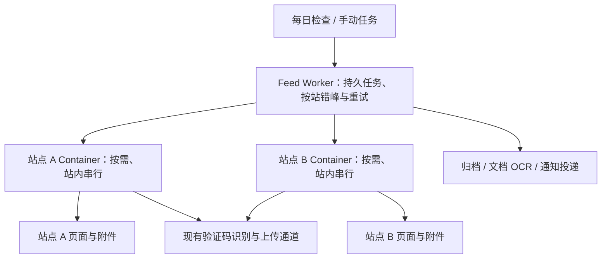

# 自有容器采集上线设计

状态：2026-11-02 已确认设计。每个站点一个按需 Container，站点错峰，同站已有任务连续串行执行；排队和长时间重试留在 Worker。确认没有就绪任务、结果传输完毕后立即请求停止容器，不为未来可能到来的任务保温；空闲检测兜底设为 1 秒。用户已授权上线自有采集方案、沿用现有验证码处理、彻底弃用 Firecrawl，并要求切换后所有栏目每日检查、上线不自动补跑旧失败任务。

发布规格：[GitHub Issue #47](https://github.com/cqu-moe/feed/issues/47)，标记 `ready-for-agent`。Issue 包含完整用户故事、实现决定、测试边界和范围限制；本文保留设计依据。

实施状态：生产尚未切换。现有 Worker 直连按站 Container、栏目发现/验证、验证码与大文件/正文 PDF 路径已实现并完成本地验证；Firecrawl 在线调用已移除。按站调度交接和每日频率迁移已实现，正在完成回归与全来源云端验收。旧草稿不作为发布依据。

## 迁移前核对事实

- 2026-11-02 核对本地及远端 main，均为 `21d780effca7eccb889c04e9229e7d5450df6e2b`。相比原探针基线，主分支已修复辅助窗口访问、栏目发现、时间提取与外部链接续页识别，正式接入必须保留这些变化。
- 生产 D1 只读结果：10 个站点、57 个采集源，其中 56 个启用。停用来源不得因更换采集执行方式自动启用；这也不是此前 10 个来源条目的原型快照。
- 同次只读核对任务状态：16 个 blocked、28 个 failed、384 个 succeeded。这些是现状快照，本次上线不自动重置或补跑这 44 个旧任务。
- 切换前同日只读核对的频率为：5 个每日、51 个每周，按 30 天约 369 轮栏目检查。新方案统一每日后，56 个启用栏目约 1,680 轮/月；这是计划轮次，不是 HTTP 请求数，分页、页面资源、正文、附件及复查、重试另计。
- 原型在本地 Docker 中验证过 10 站的列表、正文/正文型 PDF 与公开附件。标准 Playwright 在瑞数站点失败，Auth 风格的 Chrome/裸 CDP 通过；其中非零调试端口是必须保留的启动条件。原型不是完整的生产采集器。
- 原型的 Cloudflare 镜像推送两次被本地 Docker 网络断开，尚无云端来源测试；失败部署已清理。上线前必须补齐真实云端证明。
- 当前生产入口在 `worker/discovery.mjs`、`worker/source-validation.mjs`、`worker/collect.mjs`，共同调用 `worker/firecrawl.mjs` 的 `scrape`。页面动作返回列表结果，或正文、附件与原貌产物；业务层继续负责归档和完整性。
- 旧 `FeedIngest` 与 `/internal/run` 入口仍存在。迁移必须覆盖它们，确保不能绕开统一容器容量限制或残留 Firecrawl 默认调用；不能只替换新任务链路。
- `worker/page-action.mjs` 在同一源站浏览器会话内取附件、获取验证码图片并提交答案。`worker/bridge.mjs` 提供带 origin、短时 HMAC 授权和槽位去重的识别/上传通道，`worker/captcha-ai.mjs` 使用既有 Workers AI 四位数字识别模型。
- 文档 OCR 另由既有 PDF/TextIn 流程负责；附件验证码识别与文档 OCR 不混为一项。
- 既有完整性规则要求正文、应保存附件、原貌以及必要 OCR 全部完成后才可推送。失败采集不能以仅正文成功替代完整版本。
- 当前运维文档保留人民币 100 元/月的跨供应商预算及进入按量收费后的通知要求。供应商应用级上限配置中的 `0` 表示不设该项硬上限，不代表免费或自动封顶。

## 已确认范围

1. 将本轮验证的自有浏览器采集能力用于生产，而非只保留独立实验服务。
2. 验证码继续按现有处理方式执行；不更换识别供应商，不要求用户手动输入，不导入学校账号登录态。
3. 延续通知、版本、附件、原貌、PDF OCR、完整性、订阅与投递的现有业务语义。当前发布中的数据和任务身份继续有效。
4. 不把原型的全页链接匹配、附件最多 3 个或 10 MiB 上限直接当作生产规则。生产来源适配、附件边界和原貌产物须沿用当前主分支实现。
5. 彻底弃用 Firecrawl：移除线上调用、自动兜底、手动切回开关及其专用配置依赖；历史用量记录无需删除。采集故障在自有执行器和现有任务体系内修复。
6. 当前来源验收尽力逐项完成，暂态错误放慢后重试；这不等于上线后批量重放旧失败任务，也不扩大为全站历史回填。确认失效链接、解析错误或文件校验失败时记录具体原因并修复，不将所有失败推定为网络问题。
7. 一个站点对应一个稳定命名的按需容器实例；同站多个栏目共用该实例。当前 10 个站点对应 10 个实例身份，不是 56 个栏目各自一个容器，也不是 10 个全天运行的实例。
8. 不同站点的每日检查错峰安排，同站本轮已就绪的任务连续串行执行。跨站可以重叠，一个站点的慢任务不以全局串行方式阻塞所有其他站点。
9. 切换后所有现有栏目及新增目录的默认检查频率统一每日；停用栏目仍停用，既有来源校验状态与任务身份保留。按站点安排执行窗口，同站栏目尽量连续，不能将同站栏目随机分散到全天、反复冷启动。
10. 无就绪任务便立即停止容器；排队、错峰等待和长时间重试不占容器。1 秒只作为空闲检测兜底，不是每项任务完成后的强制等待，也不是平台停止计费时刻的保证。

## 部署结构与职责

现有 `cqu-feed` Worker 直接通过 Durable Object 绑定，以站点身份选取 Container。所有站点复用同一个镜像与容器类；不另建 `cqu-feed-browser` 服务或发布流水线。容器接口只由绑定调用，不挂公开抓取路由；业务状态仍由现有任务系统持有。镜像构建和发布接入当前 Feed 的 Cloudflare Builds 入口。

## 执行器边界

- 以 Cloudflare Containers 作为首个部署目标，现有 Feed Worker 按站管理浏览器容器；同一镜像保留 VPS 运行能力。初始使用 basic，是否足够由真实浏览器内存/耗时验证；有任务才启动，工作完成即释放，不依赖开发机在线。
- 从现有采集调用边界引入容器执行器，尽量复用正式列表动作和 `captchaPage`。容器承担有效浏览器会话、页面动作和所需原始产物；现有 Worker 继续负责 D1/R2、归档版本、OCR 与通知发布。
- 瑞数挑战、正文提取、验证码取图、答案提交、附件下载属于同一临时源站会话。会话不跨任务持久化，不把 Cookie 传给识别服务。
- 保留现有验证码识别和大附件上传能力，包括短时授权、来源校验、文件签名、尺寸限制、额度与调用记账。容器能调用页面脚本并不等于辅助窗口、原貌和大文件链路已经通过验收。
- 优先保持已有 `scrape(env,url,options)` 调用形状，由容器适配器返回业务层已消费的页面动作结果；不复制 Firecrawl 的 HTTP 调用或代理参数。容器请求不计入 Firecrawl credit 账本，运行时不再依赖该供应商。
- 截图继续保存，但容器原始截图使用私有字节传输/存档契约，不为模仿 Firecrawl 的 HTTPS 截图 URL 而公开图片，也不以“当前截图为可选完整性项”为由静默取消功能。
- 不新增“来源采集能力版本”或批量重置来源状态。通过当前启用采集源的云端列表/分页检查，以及各站点模板的正文、验证码附件、原貌样本验收，留存与镜像版本对应的证据。
- 同站容量在 Worker 调度层判断，已在执行的站点继续排队，不反复唤醒容器探测是否空闲。冷启动失败和暂态源站错误接入现有错误分类与延迟重试；容器忙碌响应仅作最后保护。不另建一套容器任务队列或持久重试状态。
- 采集服务入口、故障恢复和产物契约必须可审查；原貌、截图及文件的存储保持私有，不为替代 Firecrawl 引入公开存档链接。故障时可暂停新采集、保留既有阅读和任务，再回退到已验证的自有采集版本；首版没有可回退版本时先暂停并修复，不恢复 Firecrawl。

## 同步与异步边界

- Feed 已有 `feed-jobs` Queue、任务/尝试记录和 Capture/Discovery Workflow。业务触发沿用异步任务身份及查询进度的现有能力；不新增第二套任务表、队列或容器持久作业服务。
- 单次容器执行使用同步 HTTP 结果契约，供 Workflow 或受控验收调用等待；这里“同步”只表示一次调用等待结果，不要求用户页面保持连接。批量、定时和失败重试由现有异步链路负责。
- 不为“同时支持”另建公开同步业务 API。确有交互需求时，可让调用方短暂等待同一个任务；超时后返回原任务身份，不能重提一份采集。
- 当前 Discovery 步骤超时 5 分钟、Capture 步骤超时 10 分钟。容器执行须有更短的总期限，配合请求取消、进程清理和有效期内的会话；云端验收覆盖长请求、冷启动和客户端断连，不凭本地成功承诺链路超时已经解决。
- 容器停止不能中断正在执行的采集、验证码会话或未传完的结果。使用 SDK 已有的在途请求保护，不重复添加定时续活。若真实云端链路证明无法可靠等待，再在原任务身份上分离提交与结果获取，不预先增加一套持久状态。

## 同站连续执行与立即停止

1. Worker 在唤醒容器前认领该站点已到期、可执行的任务。同一站点一次只执行一个浏览器采集；批次仅表示调度分组，每篇通知和每次列表检查仍有自己的持久任务身份、结果和重试边界。
2. 同站已有任务尽量连续派发。单篇通知完成后若已有下一项就绪，继续执行，避免无必要地停止再启动；不能把这一点解释成等待未知的未来任务。
3. 没有下一项就绪且最后一项结果已经传输完毕，立即请求停止容器。停止指令只涉及释放该站运行资源，不删除归档、持久任务或实例身份；下次到期仍使用同一站点实例身份启动。
4. 明确结束信号为正常停止路径；`sleepAfter='1s'` 为漏发结束信号或请求异常结束后的空闲兜底。不得额外叠加 10 秒/1 分钟保温，也不通过定时心跳持续延长空闲期。
5. 验证码识别、源站网络响应和必要文件上传是在途采集的一部分：保留原浏览器会话并设总超时。文档 OCR、入库后处理、邮件投递以及等下一次重试均不续活容器。
6. 当前 SDK 0.3.7 已跟踪 HTTP 响应流，流结束后才递减在途计数并重设空闲计时；旧草稿每 20 秒调用 `renewActivityTimeout()` 的包装重复，应移除。每 10 秒写空白的响应保活不是新 HTTP 请求，其必要性通过真实长请求验收确定，不作为休眠控制机制。
7. 停止与新任务交接需在同站执行边界内协调：旧批次的迟到停止信号不得关闭新批次的浏览器，未传完的文件不得因空闲检测被截断。采用现有任务身份和容器生命周期能力解决，不能靠延长空闲时间掩盖竞态。
8. 官方 `stop()` 默认发送 `SIGTERM`，并不保证 API 返回时平台已完成资源回收。镜像须在结束时及时退出并清理浏览器子进程，不能拖到平台的最长退出宽限。验收分别记录结果传完、停止请求和实际停止三个时刻；1 秒是应用空闲策略，不承诺平台 1 秒内停止计费。

同站认领使用一行站点执行租约，关联现有任务与尝试，不新增任务队列。结果收完后释放租约并查询现有 outbox；有已就绪后继便立即派发，否则立即停止。容量不足在原 Workflow 尝试内 `step.sleep`，不占 Container，也不增加实际采集次数。冷启动尚未监听端口时，SDK 的一秒空闲闹钟可能提前触发；仅在这个有实际启动请求的阶段延后闹钟，正常空闲仍为一秒。

## 并发、重试与流量

- 不采用全局单例容器或固定小池替代站点隔离；每站一个实例，同站只执行一个浏览器任务。首次日检查和失败重试都按站错峰，避免上线时所有站点同步启动。平台实例上限与接入规模匹配，达到资源上限时在 Worker 等待；列表、正文、样本验证、复查及旧入口均须经过同站调度约束。
- 现有实时发现准入按全局分钟窗口计数；接入时需验证它不会把同站批次切碎后留容器空等。若某项任务尚未获得准入，继续留在 Worker，容器不为它保温；在现有调度责任层协调准入与站点窗口，不另建队列。
- 网络超时、连接中断、429 和暂态 5xx 进入已有退避重试，尊重 `Retry-After` 并加入抖动。需补齐当前错误分类中对暂态网络错误的识别；不能把容器占用当作内容损坏或消耗文章实际采集次数。
- 正式运行保留有上限的自动尝试，耗尽后保存原因和任务供恢复；重试的目的是分散源站压力，不能以无限重试保证“全部成功”。解析规则错误、确认 404、附件签名/长度/哈希不符分别修复，不盲目重复下载。
- 日常刷新检查栏目列表，首次采集按文章身份去重；既有主动复查与用户发起的历史补抓仍按各自规则运行。完整归档不因栏目刷新或更换供应商而批量重抓。
- 当前复查规则为近 30 天通知每 7 天一次、旧通知每 30 天一次，且每轮最多调度 20 篇。这会随归档总量持续增长，不能遗漏在估算之外。保留更新检测语义和既有新通知优先级，复查共享对应站点的容量限制，不允许同站多篇复查并行打开浏览器；后续按观测数据评估旧文复查频率，不在此次迁移中静默停掉它。
- 流量随栏目检查频次、实际分页/页面资源、新通知与附件字节、主动复查和重试增长。异步控制峰值和恢复能力，本身不会减少字节；错误的重试/重复投递反而会放大流量。
- 保留原貌所需资源、附件和截图，不以拦截全部图片/脚本等方式省流量。计量学校下载字节、产物上传字节、浏览器活跃时长和重试比例，先验证当前来源，再调整频率与并发；不把旧 Firecrawl credit 作为容器成本代理。

### 量级示例与计费边界

- 切换后 56 个启用栏目全部每日检查，按 30 天约 1,680 轮/月；新增 100 个每日栏目的对应增量约 3,000 轮/月。一个站点可能有多个栏目，不能直接用站点数量代替抓取量。上述数值不含正文、续页和失败重试。
- 仅作算例：每月新增 1,000 篇通知、每篇正文和附件共 10 MB，则原始内容约 10 GB/月；还需加页面依赖、截图/快照、传输编码开销和重试。这不是当前生产流量实测。
- Cloudflare Containers 官方网络出站包含量按地区为每月 500 GB 或 1 TB，超出价格为 $0.025–$0.05/GB。计入账户已有使用量，不把页面下载总量直接等同计费出站，也不假设上传到其他 Cloudflare 服务自动免容器出站费。
- 浏览器 CPU、运行中的内存/磁盘、Worker/DO、存储和 OCR 分别计费。等待网络或验证码期间，容器的内存/磁盘仍按运行时长计量；CPU 按实际使用计量。按需启动、结束即停止、增量采集和有限重试共同控制成本；流量包含量不代表所有费用免费。

## 切换前待核验

产品方向已确认，本轮无需再向用户重复提问。以下是工程验收事项，不能当作已实现能力：

- 按站实例路由、同站认领、结束与新任务交接的并发回归。
- 每日迁移以站点安排首次执行窗口；读回确认停用状态、来源配置/校验版本与旧任务终态未改变。
- 云端证明结果完整传输后及时停止；测量 1 秒空闲配置的实际停止延迟，处理退出信号而非依赖平台强制回收。
- 不靠空闲保温等待 Worker 后处理或下次定时；同站连续执行与既有发现准入、归档和复查链路一起验收。
- 列表/正文按可用内容判断就绪，避免仅因无关资源未加载完而拖长容器运行；原貌采集需要的资源保持独立完整性验证。

## 上线验收条件

1. Linux 镜像可复现构建并成功上传，现有 Feed Worker 按站启动容器实例、同站串行执行并在无任务时及时停止；确认站点隔离、错峰、任务占用和调用超时符合调度。覆盖长重试不保温、同站新任务与停止交接、结果传输未结束不被误停的情形。
2. 云端验证当前启用来源的列表与必要分页，沿用主分支的日期和来源适配规则。验证正文、正文型 PDF、直接附件、需要验证码的附件、原貌及截图。
3. 验证验证码答案在原会话提交，真实下载字节通过格式、长度、哈希检查；验证码 HTML 不得计为文件成功。
4. 归档版本和发布门槛保持：缺附件/缺原貌/必要 OCR 未完成时不推送；任务重试和已归档版本不产生重复通知。
5. 完成相关回归和仓库必需检查、审查、PR 检查，按现有发布流程合并/部署。分别记录 GitHub CI、镜像部署、Worker 发布及真实采集结果。
6. 在真实云端验收通过后切换到唯一的自有执行器，统一栏目每日检查；确认没有 Firecrawl 调用或兜底，未自动重放旧失败任务、未启用停用栏目。验证暂停新采集不影响既有阅读，记录自有版本的恢复步骤。

## 一手依据

- 当前实现：`worker/discovery.mjs`、`worker/collect.mjs`、`worker/source-validation.mjs`、`worker/page-action.mjs`、`worker/bridge.mjs`、`worker/captcha-ai.mjs`、`worker/task-runtime.mjs`。
- 当前业务与运维规则：`GLOSSARY.md`、`docs/production-design.md`、`docs/architecture/`、`docs/operations.md`、`docs/ci-cd.md`。
- 本地原型与实测：`/Users/uu/Developer/cqu-moe/feed/.worktrees/playwright-container-probe-20261102/experiments/browser-container/RESULTS.md`，逐请求记录及文件哈希同目录保存。该实验尚未提交，不能当作可下载的发布物。
- Cloudflare 官方文档（2026-11-02 通过 Context7 与官方文档工具核对）：[Containers 价格](https://developers.cloudflare.com/containers/platform/pricing/)、[容器生命周期与活动计时](https://developers.cloudflare.com/containers/api/container-class/)、[停止流程与退出信号](https://developers.cloudflare.com/containers/concepts/architecture/#container-shutdown)。
- 当前锁定 SDK `@cloudflare/containers@0.3.7`：`node_modules/@cloudflare/containers/dist/lib/container.js` 的 `containerFetch`、`decrementInflight`、`isActivityExpired` 与 `stop`；已核对在途响应保护和停止信号行为。
