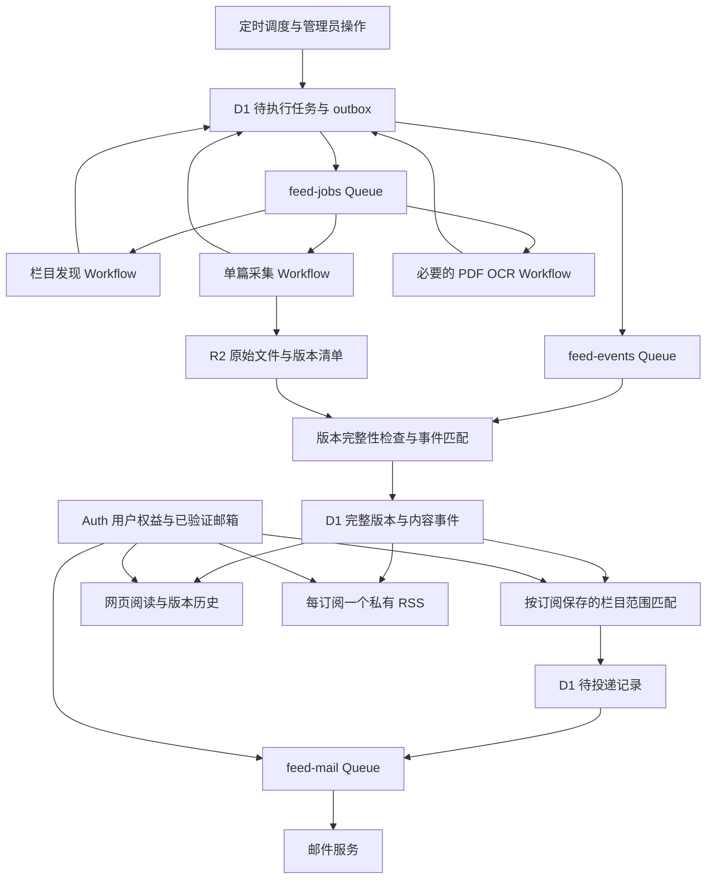
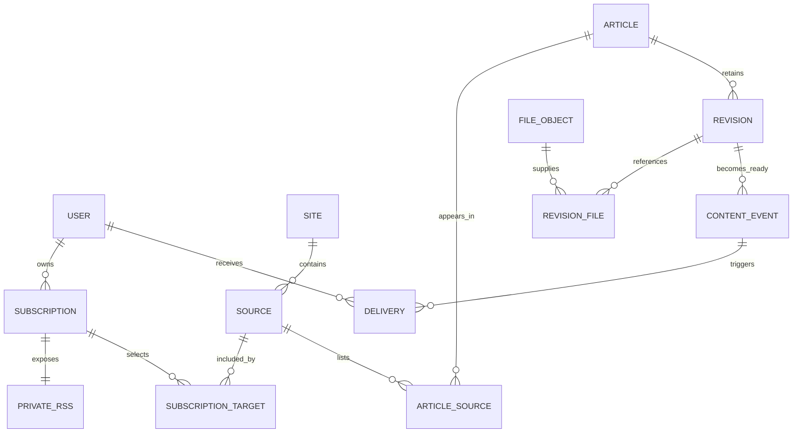

# CQU Feed 正式版架构草案

更新日期：2026-10-12（北京时间）。状态：主要业务规则已确认，数据库、执行编排与 Auth 契约已细化为可审阅的技术设计，尚未开始实现。

行为与验收已整理为 [正式版规格](specs/feed-production.md)，对应 [GitHub 总规格 #1](https://github.com/cqu-moe/feed/issues/1)。任务粒度、依赖关系与测试 Seam 已确认；实现顺序和逐项验收见 [实现计划](specs/feed-production-plan.md)。

## 细化设计入口

| 文档 | 本轮明确的内容 |
| --- | --- |
| [数据库与一致性](architecture/database.md) | 表与字段、唯一约束、不可变版本、事件时间、配额原子写入、邮件去重、outbox 和迁移 |
| [Queue / Workflow](architecture/orchestration.md) | 三条业务 Queue、三个 Workflow、消息格式、实例 ID、确认边界、重试及恢复 |
| [Auth 权益契约](architecture/auth-contract.md) | `feed.access` / `feed.sub_limit`、两个 typed RPC、已验证邮箱、服务身份、兼容和故障语义 |
| [Module 与 Interface](architecture/modules.md) | 深 Module、调用不变量、内部 Seam、实际 Adapter 与通过 Interface 验证的行为 |

下面保留业务决策与总体理由；精确的字段、消息和 Interface 以上述细化设计为准。它们是本轮提出的技术方案，不将新增技术默认误写成已由用户逐项确认。

## 架构总览

建议沿用现有 Cloudflare Worker 与前端仓库，按模块和入口拆职责，初期不拆成多个自建微服务。Auth 保持独立服务；抓取调用 Firecrawl，扫描正文继续使用现有 OCR 能力。首版不引入自建并发协调器。

图中 D1 状态与待分发事件共同持久化；队列承担交接，不能代替业务任务账本。OCR 不适用时直接参与完整性判定，不建立无意义的识别任务。

| 模块 | 负责的事实或行为 | 失败后的处理 |
| --- | --- | --- |
| 来源管理与调度 | 站点、栏目、适配规则、检查时间、历史与复查任务 | 保存失败原因与下一次检查时间，单源问题不阻塞其他源 |
| 列表发现 | 分页进度、通知 URL、发布日期及其精度、来源关联 | 从已保存的进度重试；未知日期保留待核实 |
| 文章采集 | 有效源站会话、正文、附件、原貌、文件校验 | 复用已保存产物，补抓缺项，超限转人工可处理状态 |
| 版本与完整性 | 通知身份、不可覆盖的版本、当前完整版本、必要 OCR | 未完整版本不推送；旧完整版本继续可读 |
| 订阅与 RSS | 用户拥有的独立订阅、一对一 RSS、权益和配额执行 | 暂停超额订阅的输出，保留配置 |
| 邮件投递 | 及时提醒、20:00 摘要、收件人去重与投递记录 | 有界重试，区分未提交、服务商已受理、送达及失败 |
| 管理与诊断 | 缺失附件、OCR 失败、额度耗尽、任务积压与人工补抓 | 提供具体任务／版本的恢复入口，不要求重跑整个来源 |

### 数据关系建议

实体名称用于讨论，还不是最终 SQL 表定义：

订阅目标保存明确的栏目集合。界面选择整个站点时，将该站点当前已接入的栏目展开为订阅目标；以后新建栏目不改变既有订阅范围。相同通知 URL 在多个栏目出现时建议共享通知与版本，并分别记录栏目关联；不同 URL 的转载先作为不同通知，不凭标题或正文相似度自动合并。文件对象可按内容复用，版本文件清单保持独立。

通知、采集任务、通知版本和投递记录分别拥有身份：一次失败重试不是新通知；相同任务重复入队不是新采集；重新 OCR 不是源文更新；重新发送同一邮件请求也不是新的通知事件。

## 已确认范围

以下来自本次会话中用户已经确认的范围与后续补充：

- 来源先聚焦重庆大学各部门、学院的公开网站，由管理员维护。
- 采用来源分级刷新：重要栏目每 30–60 分钟检查，普通栏目每天数次。具体分级与端到端时效指标待定。
- 正式版涵盖多源采集、存档、搜索阅读，并加入个人订阅、邮件推送和 RSS。
- 允许使用付费抓取服务；尚未确定供应商套餐和月预算上限。
- 用户倾向首版不做自建并发控制，将代理访问交给 Firecrawl。按此方向暂不引入全局并发协调器、站点级信号量或复杂配额分配器。
- 用户明确要求“都准备好再推送”：以单篇通知为单位，正文、应保存的附件、原貌等要求的归档产物以及必要 OCR 全部完成后，才允许触发推送。
- 首版订阅仅按站点或栏目筛选，不包含关键词、排除词或内容规则。
- 选择整个站点时，订阅范围只包含创建时已有的栏目，管理员以后新增的栏目不自动加入。
- 用户与订阅分开建模；每个用户可以创建多个独立订阅，数量等配额由 Auth 权益控制。
- 每个订阅对应一个私有 RSS；登录后的所有者可随时查看、复制当前链接，每条链接可独立撤销、重置，输出匹配且已准备完整的通知标题、摘要和阅读链接。持有链接的人可读其中摘要，正文和附件仍通过 Feed 登录与权益校验访问。
- 每次完整归档的实质修改在 RSS 中新增带“更新”标记的条目，使用独立事件标识并链接到对应版本；仅排版变化或 OCR 重做不产生更新条目。
- 每个订阅分别选择不发邮件、及时提醒或每日摘要，默认每日摘要。同一用户、同一批次的摘要合并为一封，对重复通知去重。
- 来源首次接入默认补抓最近一年，管理员可按来源调整；历史补抓用于存档与检索，不批量发送历史邮件。
- 新建订阅只接收订阅生效后新发布的通知；已有历史可在网页和 RSS 查看，不补发邮件。发布日期不明的条目保留待核实，不自动推送。
- 原文或附件发生实质修改时，保留新版本并在其完整归档后提醒订阅用户；仅排版变化或重新 OCR 不触发更新邮件。
- 用户要求修改过的文档各个版本都保留：已捕获的原文和附件版本不覆盖、不自动淘汰。版本保留与是否发送提醒分开判断。
- 首批／中期栏目数、活跃用户量级和月预算均由用户明确标为“待定”，不填入假定规模或购买方案。
- Auth 降低订阅配额时保留全部配置，默认按创建时间保留额度内的订阅运行，超额订阅暂停邮件和 RSS；用户可以调整保留哪些，恢复权益后可以重新启用。
- 邮件统一发送到 Auth 中当前已验证的邮箱，每个用户一个收件地址；修改邮箱走 Auth，未验证时保留订阅并暂停邮件。
- 原文修改检查覆盖全部已存档通知，按新旧分级复查；近期更频繁、旧文较低频，具体频率等容量与预算确定后再定。
- 订阅生效前发布的旧通知，在订阅生效后发生实质修改也发送更新提醒，新版本须完整归档。
- 当源站只有日级日期时，订阅生效当天及以后发布、且订阅生效后首次发现的通知可以发送新增提醒；这可能包括当天稍早于订阅发布的通知。更早日期不产生新增提醒。
- 每日摘要北京时间 20:00 发送，汇总自上次摘要窗口后已准备完整且符合条件的通知；无新内容不发，已及时提醒过的同一通知版本不再进入摘要。

讨论方式：后续问题使用 Codex 内置提问工具。未回答的问题保持未决，推荐选项不等同于用户决定。

## 当前实现依据

- 基线：`1ab3b98`，现有 MVP 位于 `feed/mvp`，设计记录在独立 `docs/production-design` 分支。
- `worker/sources.json` 配置 5 个来源；现有来源对象可能同时包含多个列表 URL，正式版需要明确站点与栏目的关系。
- `worker/workflow.mjs` 为每个来源创建 Workflow，同一来源内部逐篇采集；每日运行，最近 30 天为发现窗口。
- `worker/firecrawl.mjs` 在请求前占用共享日额度；当前配置每天最多 120 次调用，列表发现也计入。
- 原始产物写入 R2，元数据与搜索索引写入 D1；正文型 PDF OCR 有独立 Workflow。
- `worker/collect.mjs` 在触发 PDF OCR 前写入文章的 `complete` / `partial` 状态；因此现有文章 `complete` 不足以代表正式版的“可推送”。`worker/pdf-ocr.mjs` 的 `publishPdfText` 会检查当前正文 PDF 的识别结果是否齐备，但其 `publish` 指发布阅读文本，并非向订阅用户发送通知。
- 已完成的文章不会自动重新检查源站修改。
- 当前业务访问通过 Auth 与 `feed.access` 控制；RSS 和后台邮件如何关联访问权益尚待明确。
- Auth 主检出比本地 `origin/main` 落后 3 个提交。本次只读核对本地 `origin/main`（`02b4f47`）及 `feat/feed-access` worktree：已定义 `feed.access`，尚未定义 Feed 数量配额；`AuthService.getCaps` 仍只允许 calendar 子系统。未刷新远端或验证生产，这些是本地代码证据。
- Feed 当前 OAuth 登录请求未包含 `email` scope；`fetchUserInfo` 未保存 `email_verified`。正式版须通过明确授权的 Auth 契约取得当前邮箱及验证状态，不能把本地会话里存在 email 当成已验证。

以上是本地代码与文档事实，不代表本轮已验证生产运行情况。

## 设计方向

保留现有 Cloudflare 基础，将来源调度、列表发现、文章采集、衍生处理、订阅匹配、邮件投递与 RSS 读取分开建模。本轮建议三条业务 Queue 配三个 Workflow，保留一个代码库和 Worker 部署单元。

- 采集成功、内容可读、归档完整与邮件送达分别记录，避免一个状态同时承担多种含义。
- 邮件失败重试复用投递记录，不触发重新抓取；同一通知命中多个订阅时去重，同一用户同一批次的每日摘要合并。
- 新通知发现与历史补抓需要独立优先级，防止历史任务耗尽刷新预算。
- RSS 应读取已保存结果，避免阅读器请求直接触发采集。

### 当前建议：Queues 分发，Workflows 执行抓取

用户提出抓取也应使用 Cloudflare Queues 或 Workflows。本轮细化的组合如下：

1. 定时调度选出到期栏目，建立持久任务和 outbox，通过 feed-jobs 启动独立列表发现 Workflow；文章采集与 OCR 同样通过这条队列交接。
2. 列表发现 Workflow 处理一个栏目的一次检查，分页结果和新文章任务持久化，允许下次从保存的进度继续。
3. 每篇文章的一次采集任务对应独立 Workflow。抓取与保存原始结果、派生处理和发布内容分成有明确持久化边界的步骤；现有 PDF OCR Workflow 可继续独立运行。
4. feed-events 负责完整性判定与分批订阅匹配，避免订阅用户增长拖住抓取 Workflow；固定邮件快照与去重记录后，交 feed-mail 发送。每个私有 RSS 读取对应栏目的完整且日期已核实事件，输出标题、摘要和版本阅读链接。

### 用户、订阅与权益

以下实体边界落实用户已经确认的关系，字段和约束已展开在数据库设计中：

- 用户：由 Auth 身份标识关联；拥有多个订阅。
- 订阅：独立保存名称、明确的栏目集合、生效时间、启用状态和邮件模式。选择站点只是一次性选中当时已有栏目，不在读取时动态展开站点。首版不设计关键词规则引擎。
- 私有 RSS：与订阅一对一，持有独立凭证及撤销／重置状态；一个用户拥有多个 RSS 是通过拥有多个订阅实现的，不创建跨订阅聚合 RSS。
- 订阅命中：记录通知或版本为何出现在某个订阅中，用于网页、RSS 与邮件共享内容选择逻辑。
- 邮件投递：按收件人和通知事件去重，保存独立状态；每日摘要按用户及北京时间窗口归并。已及时提醒过的同一通知版本不再进入摘要。

Auth 是能力与配额事实源；Feed 持有订阅、RSS 及用量记录，原子限制创建数量，按当前额度计算运行集合。能力键采用既有 `feed.access` 与新增 `feed.sub_limit`，数值和预设仍待定，不在 Feed 写死档位。RSS 与订阅一对一，不因凭证轮换消耗新的订阅数量。

后台投递与 RSS 拉取不能依赖用户一直保持浏览器登录，使用经服务身份认证且限定 Feed 子系统的 `getFeedPolicy` / `getFeedRecipient` 新 RPC。当前 `getCaps` 保持 calendar 兼容行为；新接口区分缺失、有限、无限和查询失败。邮件上下文同次返回权限与已验证邮箱。

权益接口应区分“明确无权／配额不足”和“Auth 暂时不可用”。后者暂停相关发送或读取并允许恢复，不能按永久撤销删除订阅或版本。缺失配额与无限配额的表示需沿用并核对 Auth 契约，不能把网络失败解释成无限额度。

配额下降按用户确认的策略暂停超额订阅，保留其配置和 RSS 身份。建议分别保存用户的启用意愿与因权益不足而暂停的原因，避免自动覆盖用户主动关闭的状态。默认按创建时间保留额度内订阅，允许用户调整运行顺序。RSS 暂停时不输出内容；恢复与永久撤销／重置凭证是不同操作。

收件邮箱以 Auth 当前已验证值为准；发送前重新核实。Auth 暂时不可用时延期，邮箱未验证时暂停。邮箱变更、退信和退订不删除存档或订阅配置。后台接口只能对已授权的 Feed 服务披露目标用户的 Feed 权益和投递所需最少资料，不能复用或导出用户浏览器会话。

### 文档及文件的版本保留

- 通知身份与版本分离；同一 URL 的正文或附件变化形成新版本，旧内容继续可查看。
- 每个版本关联当时的正文、附件清单、原始文件、原貌产物和识别结果。新版本替换或删除某个附件，不改变旧版本对旧文件的引用。
- 原始文件使用不可覆盖的对象标识；相同字节的文件允许复用物理对象，但每个版本保留自己的引用和清单。文件名相同不能作为覆盖旧文件的依据。
- OCR 等派生内容保留输入文件与处理版本的对应关系，更新识别结果不伪装成源站发布了新版本，也不触发原文修改邮件。
- 每次检测到的变更都可以留档；“保留版本”不等于“每次都提醒”。仅排版变化不提醒，实质正文或附件变更在新版本完整后产生更新事件。
- 邮件中的事件及版本引用应稳定，避免稍后打开时无从判断当时推送的是哪个版本。RSS 为每次完整归档的实质修改建立独立“更新”条目，链接到对应版本，不覆盖原条目的事件身份。
- 复查覆盖全部存档，按新旧分级安排，具体频率待容量与预算确定。轮询只能记录实际观察到的版本，不能还原两次访问之间出现后又被覆盖的状态。

### 历史与新增通知

- 来源接入时建立历史补抓任务和日常发现任务的边界；历史任务默认覆盖过去一年，不产生历史邮件洪峰。
- 新建订阅保留生效时间；历史通知可进入网页与 RSS，但不能因为新订阅、重试或补抓就被当成新发布通知发送。
- 发布日期未知的通知可以归档，推送资格保持待核实。
- 有准确发布时间时，新增提醒按发布时间与订阅生效时间判断；只提供日级日期时，按用户确认的当天边界并结合首次发现时间判断，日期未知先不发送。
- 旧通知在订阅生效后发生实质修改，可以发送更新提醒；比较的是新观察到的变化事件，而非把旧文原始发布日期改成当前日期。
- 历史补抓遇到一个此前未存档的页面，只建立历史基线，不能因为当前获取到了内容就制造更新事件。订阅前已发现、订阅后才因补抓完成的旧事件也不能被重新包装为订阅后的变化。

### 栏目范围与 RSS 更新

- 创建订阅时持久化用户选中的栏目集合；选择整个站点则保存当时的栏目清单。后续新增栏目不会自动改变该清单。
- 建议允许用户显式编辑栏目范围，并为新加入的栏目记录加入时间；移除后不再匹配新事件，扩大范围不补发旧邮件。这样不会把订阅的原始创建时间错误应用于后来添加的栏目。
- RSS 的首次通知条目和实质更新条目拥有稳定且不同的事件标识；重复拉取、重新生成 feed 或重试任务不会制造更多更新条目。
- 更新条目标明“更新”并链接到具体版本，原始发布日期与此次修改的发现／就绪时间分开保存，避免把旧通知伪装成新发布。
- 未完整的新版本不进入 RSS；历史完整版本继续可读。RSS 是订阅结果的读取入口，不因阅读器刷新触发采集。

### 每日摘要与投递去重

- 每天北京时间 20:00 收集上个摘要窗口后新达到完整状态、满足订阅资格的事件；以版本完整就绪时间纳入窗口，避免漏掉稍晚补齐附件的通知。
- 同一用户所有每日摘要订阅合并成一封，通知版本去重。没有待发送内容时不发空邮件。
- 已经及时提醒过的同一通知版本从摘要中排除。建议及时发送与摘要共用一份投递占用／结果记录，避免两个任务同时看到“尚未发送”而各发一遍。
- 每封摘要在提交给邮件服务前固定内容和幂等标识，重试复用同一快照；不能用当前查询结果重新拼装已经提交过的摘要。
- 邮件模式变化、暂时失败和 Auth 暂时不可用不抹掉事件资格或投递结果；超时结果不明时先对账，避免盲目重发。

### 完整后推送

用户已选定完整后推送，建议以统一的就绪判定落实：

- 以当前采集版本为范围检查正文、要求的归档产物、附件和必要 OCR。无附件或无需 OCR 的通知，该项记为不适用，避免永远等待。
- 某一项失败、额度不足或仍在处理时保留缺项原因，不触发推送；只补齐缺失项，成功产物可复用。
- 达到重试上限的条目继续保持不可推送，并进入管理员可查看与重试的失败列表，不自动降级为部分完成。
- 归档和 OCR 的完成事件均可触发一次重新判定；对同一通知版本的就绪事件去重，避免重复匹配和重复投递。
- 单篇通知就绪后即可进入匹配，不等待同一栏目或其他来源的全部通知完成。
- 普通附件是否也提取全文尚未确定；当前“必要 OCR”指为读懂正文所需的文字识别，不把未确认的通用附件全文索引强加为推送前置条件。

关键边界：

- Queues 负责交接与缓冲，Workflows 负责已接收任务的步骤执行与恢复。队列确认表示 Workflow 已可靠接手，不表示文章抓取完成。
- 同一任务使用稳定的标识；重复消息不能创建另一份业务任务。显式重抓是新的采集任务，不能只按文章 URL 永久去重。
- 队列消费者的 `max_concurrency` 限制消费者调用数。消费者启动 Workflow 后很快返回，因此该设置不能作为实际抓取并发的上限。按用户最新方向，首版接受平台自动并行和供应商限流，不另建并发协调层。
- Firecrawl 的 `proxy: auto` 负责在 basic 失败后尝试 enhanced 代理；它不会取消账号的 API 频率与并发浏览器上限。官方将 API 限流和并发达到上限均列为 429。抓取步骤遇到 429 时遵守可用的 `Retry-After`，否则使用有抖动的退避，并限制重试次数/总时长；这属于失败处理。
- 402 或额度耗尽不进入快速重试循环，保存延期原因并等待额度恢复或管理员处理。月预算上限仍待用户确定。
- Queue 交接重试、Workflow 步骤重试和供应商客户端重试要分清职责，避免层层重试放大调用量。终止的 Workflow 需独立记录和恢复入口，不会因曾有队列消息就自动进入死信队列。
- 同源页面会话内的验证码与附件下载保持一个采集单元；Workflow 保存进度并不保存远端浏览器会话。后续附件补抓需显式重新建立有效会话。
- HTML、截图、PDF 和其他附件写 R2，任务消息和步骤返回值只传标识、对象引用和小型摘要。
- 数据更新与待分发事件写入同一 D1 事务，再由可重试的分发器送入队列，弥补数据库已保存但消息未发送的空窗；接受重复并进行业务去重。
- Workflow 步骤可能重试外部操作；能查询已有结果时优先复用，供应商支持时使用幂等键。不能承诺付费抓取在网络结果不明时绝对只扣费一次。

对于邮件候选服务 Resend，官方说明 `email.sent` 只表示 API 请求成功，`email.delivered` 表示收件方邮件服务器接收；不能将其等同于用户已阅读。其幂等键有效期为 24 小时，因此应用仍需持久投递记录，并处理超出窗口后的不确定状态。供应商尚未选定。

## 待整体确认的默认行为

以下是技术草案建议，尚未逐项获得用户确认：

- 订阅编辑仅影响此后的匹配，扩大栏目范围不补发旧邮件。
- 源站暂时访问失败只标为不可访问，不据此断言删除；已保存版本继续保留，首版不发撤回邮件。
- 管理员可配置／暂停栏目、查看失败步骤与缺失产物、按任务补抓。来源进入定时采集前，先通过列表、正文、分页、附件与原貌的一组样本验收。
- 用户可暂停单个订阅的邮件、全部邮件或 RSS。退信／投诉暂停对相应邮箱的发送，订阅与归档数据继续保留。

## 实施前需细化与上线前需补齐

- 容量与月预算暂缓确定；在选择付费套餐和制定上线吞吐目标前再估算。
- 审阅这些细化设计，随后转为实际迁移、Interface 实现与故障注入验收；Auth 额度预设仍需在开放新订阅前指定。
- 修改复查的分级频率、供应商套餐、邮件服务、有限重试参数和可观测指标阈值。
- 来源配置的字段与站点适配器接口；同源浏览器会话内可复用和必须重跑的边界。
- MVP 数据导入与不可变版本基线、迁移切换、回滚和正式版验收规格。

## 建议的关键验收场景

- 一次发现多篇通知，其中一篇附件失败：其他完整通知可正常进入订阅输出，失败文章保留缺项原因并能单独补抓。
- 抓取已完成但 OCR 延迟：不提前推送；OCR 完成后只产生一次就绪事件。
- 同一任务或就绪事件重复投递：不建立重复业务任务，不重复发送同一通知版本。
- 同名附件被源站替换：新旧文件均可从对应版本读取，更新提醒指向正确版本。
- 一篇通知命中同一用户多个订阅：摘要只出现一次；及时提醒成功后不再进入摘要。
- 新来源一年历史补抓、新建订阅及未知发布日期：分别符合已确认的历史邮件抑制和日期边界规则。
- Auth 配额下降或邮箱未验证：配置仍在，相应输出暂停；Auth 暂时故障不得删除配置或误判无限配额。
- 重置一条 RSS 链接：旧凭证失效，不影响同一用户的其他订阅或 RSS。
- 用户选择整个站点后，管理员新增一个栏目：旧订阅范围不变；用户显式编辑加入该栏目后才匹配其后续事件。
- 一篇通知发生实质修改：新版本完整后 RSS 多一个稳定的“更新”条目，指向正确版本；反复拉取或任务重试不增加重复条目。
- Worker 重启、Queue 重复消费、Workflow 步骤重试或数据库已提交但尚未入队：任务可恢复，内容事件和投递状态可追溯。
- 迁移 MVP 数据：原有可访问存档、文件与身份关系保留；既有文章导入为基线，不触发历史邮件。

## 本轮验证记录

变更限于架构设计与工程技能文档，未改产品代码、创建数据库迁移或部署资源。文档内部链接、代码块和空白检查通过；配额条件 INSERT 示例在本地 SQLite 验证了额度耗尽时不会创建孤立栏目目标，这不等于已验证 D1 并发行为。Module 复查与技能配置后，现有 MVP 的 `pnpm test` 再次为 23/23 通过，`pnpm build` 与 `pnpm check:design` 通过；构建保留既有大 chunk 提示。测试运行需要允许 Miniflare 监听本机地址。主检出保持干净。

工程技能使用 GitHub Issues、默认五个 triage 标签和 single-context 领域布局；用户确认完整草稿后写入 `AGENTS.md` 与 `docs/agents/`。已补齐并读回 GitHub 缺少的四个标签，原有 wontfix 保留。日后直接编辑这些配置即可，领域 ADR 在形成决策时按需创建。

## 参考

- [Cloudflare：从 Workflow 启动独立 Workflow](https://developers.cloudflare.com/workflows/build/trigger-workflows/)
- [Cloudflare：队列消费者并发](https://developers.cloudflare.com/queues/configuration/consumer-concurrency/)
- [Cloudflare：Workflow 持久步骤、重放与幂等](https://developers.cloudflare.com/workflows/build/rules-of-workflows/)
- [Resend：幂等键](https://resend.com/docs/dashboard/emails/idempotency-keys)
- [Resend：投递事件](https://resend.com/docs/webhooks/event-types)
- [Firecrawl：API 错误与重试说明](https://github.com/firecrawl/firecrawl-docs/blob/main/api-reference/errors.mdx)
- [Firecrawl：API 频率与团队额度](https://github.com/firecrawl/firecrawl-docs/blob/main/rate-limits.mdx)
- [Firecrawl：代理参数](https://github.com/firecrawl/firecrawl-docs/blob/main/api-reference/v2-openapi.json)
- 本地 `worker/workflow.mjs`、`worker/firecrawl.mjs`、`worker/auth.mjs`、`README.md`。
