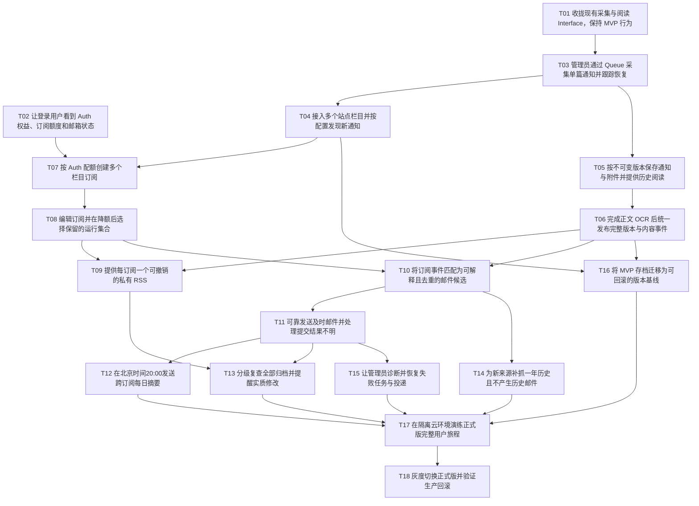

# CQU Feed 正式版 v1 实现计划

日期：2026-10-12。规格见 [正式版规格](feed-production.md)，已发布为 [GitHub 总规格 #1](https://github.com/cqu-moe/feed/issues/1)。T 编号是稳定计划编号，不是 GitHub issue 编号。任务均以 ready-for-agent 发布，但只有所有 blocker 已完成的 frontier 可领取。

## 已发布的 GitHub Issues

总规格与 18 个子 Issue 均保持 Open，并带 ready-for-agent 标签。2026-10-12 已逐项读回核对正文、124 条验收标准、18 个原生父子关系和 25 条原生阻塞关系；依赖图无环，覆盖规格全部 53 条用户故事。此记录证明规格和任务发布完成，不表示任务已实现。

| 计划编号 | GitHub Issue | 原生 Blocked by |
| --- | --- | --- |
| T01 | [#2 收拢现有采集与阅读 Interface，保持 MVP 行为](https://github.com/cqu-moe/feed/issues/2) | 无，可立即开始 |
| T02 | [#3 让登录用户看到 Auth 权益、订阅额度和邮箱状态](https://github.com/cqu-moe/feed/issues/3) | 无，可立即开始 |
| T03 | [#4 管理员通过 Queue 采集单篇通知并跟踪恢复](https://github.com/cqu-moe/feed/issues/4) | [#2](https://github.com/cqu-moe/feed/issues/2) |
| T04 | [#5 接入多个站点栏目并按配置发现新通知](https://github.com/cqu-moe/feed/issues/5) | [#4](https://github.com/cqu-moe/feed/issues/4) |
| T05 | [#6 按不可变版本保存通知与附件并提供历史阅读](https://github.com/cqu-moe/feed/issues/6) | [#4](https://github.com/cqu-moe/feed/issues/4) |
| T06 | [#7 完成正文 OCR 后统一发布完整版本与内容事件](https://github.com/cqu-moe/feed/issues/7) | [#6](https://github.com/cqu-moe/feed/issues/6) |
| T07 | [#8 按 Auth 配额创建多个栏目订阅](https://github.com/cqu-moe/feed/issues/8) | [#3](https://github.com/cqu-moe/feed/issues/3)、[#5](https://github.com/cqu-moe/feed/issues/5) |
| T08 | [#9 编辑订阅并在降额后选择保留的运行集合](https://github.com/cqu-moe/feed/issues/9) | [#8](https://github.com/cqu-moe/feed/issues/8) |
| T09 | [#10 提供每订阅一个可撤销的私有 RSS](https://github.com/cqu-moe/feed/issues/10) | [#7](https://github.com/cqu-moe/feed/issues/7)、[#9](https://github.com/cqu-moe/feed/issues/9) |
| T10 | [#11 将订阅事件匹配为可解释且去重的邮件候选](https://github.com/cqu-moe/feed/issues/11) | [#7](https://github.com/cqu-moe/feed/issues/7)、[#9](https://github.com/cqu-moe/feed/issues/9) |
| T11 | [#12 可靠发送及时邮件并处理提交结果不明](https://github.com/cqu-moe/feed/issues/12) | [#11](https://github.com/cqu-moe/feed/issues/11) |
| T12 | [#13 在北京时间20:00发送跨订阅每日摘要](https://github.com/cqu-moe/feed/issues/13) | [#12](https://github.com/cqu-moe/feed/issues/12) |
| T13 | [#14 分级复查全部归档并提醒实质修改](https://github.com/cqu-moe/feed/issues/14) | [#10](https://github.com/cqu-moe/feed/issues/10)、[#12](https://github.com/cqu-moe/feed/issues/12) |
| T14 | [#15 为新来源补抓一年历史且不产生历史邮件](https://github.com/cqu-moe/feed/issues/15) | [#11](https://github.com/cqu-moe/feed/issues/11) |
| T15 | [#16 让管理员诊断并恢复失败任务与投递](https://github.com/cqu-moe/feed/issues/16) | [#12](https://github.com/cqu-moe/feed/issues/12) |
| T16 | [#17 将 MVP 存档迁移为可回滚的版本基线](https://github.com/cqu-moe/feed/issues/17) | [#5](https://github.com/cqu-moe/feed/issues/5)、[#7](https://github.com/cqu-moe/feed/issues/7) |
| T17 | [#18 在隔离云环境演练正式版完整用户旅程](https://github.com/cqu-moe/feed/issues/18) | [#13](https://github.com/cqu-moe/feed/issues/13)、[#14](https://github.com/cqu-moe/feed/issues/14)、[#15](https://github.com/cqu-moe/feed/issues/15)、[#16](https://github.com/cqu-moe/feed/issues/16)、[#17](https://github.com/cqu-moe/feed/issues/17) |
| T18 | [#19 灰度切换正式版并验证生产回滚](https://github.com/cqu-moe/feed/issues/19) | [#18](https://github.com/cqu-moe/feed/issues/18) |

当前可启动：[T01 / #2](https://github.com/cqu-moe/feed/issues/2) 与 [T02 / #3](https://github.com/cqu-moe/feed/issues/3)。其他任务只在自己的 blocker 全部完成后启动。

## 已确认的测试 Seam

主验收沿用现有 Worker 的用户/管理员入口，观察阅读、订阅、RSS、邮件 Adapter 接收记录与管理状态。只有可控时钟、故障注入及异步重放走已设计的 Module Interface；D1/R2 使用 Miniflare，Auth/抓取/OCR/邮件使用明确的生产和测试 Adapter。现有安全验收继续保留，云端真实交接与真实账号单独验收。

## 编号拆分与交付

1. **T01 收拢现有采集与阅读 Interface，保持 MVP 行为** — **Blocked by:** 无，可立即开始。**交付：**保持当前来源从管理员触发采集到登录阅读、PDF/附件下载的完整路径可用，将租约、归档状态与 OCR 发布规则逐步收进 Archive/Sources Interface，给后续正式版切片提供稳定入口。本项是前置整理，不一次性重写整个 Worker。

2. **T02 让登录用户看到 Auth 权益、订阅额度和邮箱状态** — **Blocked by:** 无，可立即开始。**交付：**跨 Auth 与 Feed 打通新的最小披露契约，使当前登录用户在账户/订阅入口看到 Feed 访问权限、订阅额度和邮箱是否可用于投递；后台后续可使用同一 Adapter 查权，不依赖用户浏览器常驻。

3. **T03 管理员通过 Queue 采集单篇通知并跟踪恢复** — **Blocked by:** T01。**交付：**管理员对现有已配置来源的一篇通知发起采集，在管理入口看见持久任务、接手、完成或延期结果；即使重投或启动时中断也可恢复，不靠重新扫描整个栏目。此切片引入 TaskRuntime、feed-jobs、对应 DLQ 和单篇 CaptureWorkflow。

4. **T04 接入多个站点栏目并按配置发现新通知** — **Blocked by:** T03。**交付：**管理员维护站点与栏目，完成样本验证后启用定时发现；每个栏目的一次有限分页检查产生独立文章任务，某一来源失败不阻塞其他来源。

5. **T05 按不可变版本保存通知与附件并提供历史阅读** — **Blocked by:** T03。**交付：**读者可以从通知时间线查看实际捕获的每个版本及当时附件；新采集不会覆盖旧文件，同一内容回退再次出现也保留独立观测。

6. **T06 完成正文 OCR 后统一发布完整版本与内容事件** — **Blocked by:** T05。**交付：**采集和正文 OCR 通过同一完整性判定汇合；只有该版本所有必需项齐备，读者才看到完整新版、搜索投影和可被订阅消费的稳定内容事件。

7. **T07 按 Auth 配额创建多个栏目订阅** — **Blocked by:** T02、T04。**交付：**登录用户可以按站点或栏目创建多个独立订阅，立即看到保存结果、额度和运行状态；每个订阅预留唯一私有 RSS 身份，默认每日摘要。

8. **T08 编辑订阅并在降额后选择保留的运行集合** — **Blocked by:** T07。**交付：**用户可以编辑栏目、启停/删除订阅、调整优先级及轮换/撤销 RSS；额度变化只影响实际运行集合，不丢配置或主动关闭意愿。

9. **T09 提供每订阅一个可撤销的私有 RSS** — **Blocked by:** T06、T08。**交付：**用户将自己的私有链接加入阅读器，即可看到所选栏目中的完整通知和历史内容；每个事件稳定去重，链接与权益变化即时参与读取判断。

10. **T10 将订阅事件匹配为可解释且去重的邮件候选** — **Blocked by:** T06、T08。**交付：**用户在订阅详情看到匹配的新通知与更新状态，管理员能解释某事件为何待发送、被历史规则抑制或仍待日期核实；共享事件不会给同一用户制造重复投递候选。

11. **T11 可靠发送及时邮件并处理提交结果不明** — **Blocked by:** T10。**交付：**及时模式用户收到一封指向完整版本的邮件；发送前检查当前权益与已验证邮箱，重投/网络中断不会变成盲目的第二封邮件，并能查看投递进度。

12. **T12 在北京时间20:00发送跨订阅每日摘要** — **Blocked by:** T11。**交付：**每日摘要模式用户在北京时间 20:00 收到一封合并邮件；同一用户多个订阅去重，及时提醒和延迟处理的事件不会重复或丢失。

13. **T13 分级复查全部归档并提醒实质修改** — **Blocked by:** T09、T11。**交付：**系统持续复查新旧通知，原文或附件实质变化形成完整新版本后，RSS 出现更新条目、及时订阅收到更新邮件；排版/OCR 变化只留记录。

14. **T14 为新来源补抓一年历史且不产生历史邮件** — **Blocked by:** T10。**交付：**管理员对新来源启动默认一年的历史补抓，在管理入口观察进度，读者逐步查到历史存档；历史不会被当成新发布或新更新进入邮件候选。

15. **T15 让管理员诊断并恢复失败任务与投递** — **Blocked by:** T11。**交付：**管理员从统一状态入口定位积压、缺项、死信、额度耗尽和邮件结果不明，恢复指定工作并验证成功部分未被重跑。 本项只接入 T03–T11 已存在链路；摘要、复查、补抓与迁移在各自任务中验收恢复行为，复用通用诊断能力，不由本项包办新增业务。

16. **T16 将 MVP 存档迁移为可回滚的版本基线** — **Blocked by:** T04、T06。**交付：**维护者把已有通知、附件、来源和 OCR 结果导入新模型，读者仍能登录搜索阅读原有资料；逐步切换读取并可回滚，不向用户补发历史邮件。

17. **T17 在隔离云环境演练正式版完整用户旅程** — **Blocked by:** T12、T13、T14、T15、T16。**交付：**在隔离 Cloudflare/Auth/邮件配置下完成从多源发现到完整归档、订阅、RSS、邮件、更新和失败恢复的真实旅程，形成上线前可以复核的证据。

18. **T18 灰度切换正式版并验证生产回滚** — **Blocked by:** T17。**交付：**在已通过隔离验收和明确资源配置的前提下，按来源/用户逐步开启正式版，证明线上采集、阅读、RSS和邮件可用，并保留回滚能力。

## 依赖图

## 实现顺序

以下是依赖满足后的并行波次，不是要求等待整个波次结束的批处理。某任务自己的 blocker 完成后即可启动。

1. T01、T02
2. T03
3. T04、T05
4. T06、T07
5. T08、T16
6. T09、T10
7. T11、T14
8. T12、T13、T15
9. T17
10. T18

T01 是先保持行为的整理；T02 涉及 Auth 与 Feed，但不依赖采集重构。版本存档、来源管理可并行；RSS 与邮件匹配也可并行；摘要、修改提醒、恢复和迁移在各自依赖完成后推进。最终两个任务分别记录隔离演练与生产灰度，不能把本地测试当上线成功。

数值预算、套餐、默认额度、实际收件人和上线授权仍是明确的外部条件；不虚构这些值，不把它们变成所有代码任务的阻塞边。

## 每个任务的完整验收

### T01 收拢现有采集与阅读 Interface，保持 MVP 行为

**Blocked by:** 无，可立即开始

**覆盖用户故事：**1、2、3、4、5、48、53

**What to build:** 保持当前来源从管理员触发采集到登录阅读、PDF/附件下载的完整路径可用，将租约、归档状态与 OCR 发布规则逐步收进 Archive/Sources Interface，给后续正式版切片提供稳定入口。本项是前置整理，不一次性重写整个 Worker。

**Acceptance criteria**

- [ ] 同一组现有来源样本仍可触发采集、查看正文/快照/PDF 和下载附件，用户可见行为保持兼容。
- [ ] 采集任务经 Archive Interface 执行，调用者不再自行领取租约、拼接成功/失败状态；管理员与定时入口复用相同规则。
- [ ] 外部依赖在组装时注入；既有站点会话和桥接 origin、签名、有效期、文件类型校验保留。
- [ ] 从已有 Worker/Module Interface 验证中文搜索、PDF Range、登录实时权益、OCR 旧输入保护和延期恢复；先保留独有安全测试。
- [ ] 重构提交可独立通过现有测试、构建和设计检查，不改变生产数据模型或默认打开新功能。

### T02 让登录用户看到 Auth 权益、订阅额度和邮箱状态

**Blocked by:** 无，可立即开始

**覆盖用户故事：**28、29、30、34、53

**What to build:** 跨 Auth 与 Feed 打通新的最小披露契约，使当前登录用户在账户/订阅入口看到 Feed 访问权限、订阅额度和邮箱是否可用于投递；后台后续可使用同一 Adapter 查权，不依赖用户浏览器常驻。

**Acceptance criteria**

- [ ] Auth 新增 feed.sub_limit，并明确区分 limited、unlimited、missing；0/缺失/非法值都不会变成无限额度。
- [ ] getFeedPolicy 与 getFeedRecipient 只披露 Feed 权益，后者在同次读取中返回权限和当前已验证邮箱；未验证或无访问权时不披露地址。
- [ ] Feed 使用独立服务身份、方法与子系统白名单和 AuthService named binding；业务调用只传目标身份，secret/版本 envelope 不出 Adapter。
- [ ] 账户界面区分未配置、零、有限、无限、邮箱未验证和暂不可用；目标身份只取已验证会话或可信订阅归属。
- [ ] 错误客户端/方法配置、用户不可用、数据非法与 Auth 暂不可用分别处理，不将服务故障批量解释为用户撤权。
- [ ] 现有 calendar/getCaps、Feed OAuth BFF、feed.access 实时检查与原登录行为回归通过；本项不擅自指定套餐额度。
- [ ] 使用 Auth/Feed 契约测试与真实本地 Adapter 验证上述值矩阵；云端 binding/真实账号验收留有独立待验证状态。

### T03 管理员通过 Queue 采集单篇通知并跟踪恢复

**Blocked by:** T01

**覆盖用户故事：**22、46、47、48、49、50

**What to build:** 管理员对现有已配置来源的一篇通知发起采集，在管理入口看见持久任务、接手、完成或延期结果；即使重投或启动时中断也可恢复，不靠重新扫描整个栏目。此切片引入 TaskRuntime、feed-jobs、对应 DLQ 和单篇 CaptureWorkflow。

**Acceptance criteria**

- [ ] 管理入口可提交一次明确采集意图并返回稳定 taskId，在状态页看到 queued/starting/running/succeeded/deferred/failed 等可区分事实。
- [ ] 任务和启动 outbox 原子落盘；数据库提交后未入队、入队后未标记等中断均可恢复。
- [ ] 同一请求/同一 attempt 重投复用同一 Workflow instance ID；create 成功但记账失败时查询同 ID，不创建随机新实例。
- [ ] Queue 只在指定 Workflow 已可靠接手或已有终态后确认；启动后执行失败在任务账本中可见，不依赖启动 Queue DLQ 代替。
- [ ] 429 有界退避，402/预算耗尽保存延期原因，不形成快速付费重试；不引入全局/每站点并发器。
- [ ] Cloudflare 消息与步骤结果只传小型 ID/引用；同源验证与依赖该会话的下载保持可重建采集单元。
- [ ] 通过管理入口与受控重放验证一篇通知的采集到阅读；本地模拟与实际 Cloudflare 交接证据区分记录。

### T04 接入多个站点栏目并按配置发现新通知

**Blocked by:** T03

**覆盖用户故事：**1、10、40、41、42、47

**What to build:** 管理员维护站点与栏目，完成样本验证后启用定时发现；每个栏目的一次有限分页检查产生独立文章任务，某一来源失败不阻塞其他来源。

**Acceptance criteria**

- [ ] 管理界面可创建/编辑/暂停站点和栏目，保存 adapter 配置、配置版本、刷新间隔及样本检查结果。
- [ ] 新配置必须验证列表、分页、正文和附件/原貌样本后才能进入定时采集；任务保存所用配置快照。
- [ ] 到期栏目经 feed-jobs 启动独立 DiscoveryWorkflow，分页进度、来源关联和文章任务同批持久化；中断从已提交游标继续。
- [ ] 重要栏目可配置 30–60 分钟、普通栏目每天数次；调度只选择到期项，单源失败不阻塞另一来源。
- [ ] 同 canonical URL 出现在两个栏目时共享通知身份且保留两条来源关联；不同 URL 的转载不自动合并。
- [ ] 来源首次发现时间、日期精度、时区与 live/backfill 分类可追踪；未知日期不会被补成当前日期。
- [ ] 受控多源样本可在阅读入口按来源过滤；暂停来源阻止新调度，仍可读取已保存内容。

### T05 按不可变版本保存通知与附件并提供历史阅读

**Blocked by:** T03

**覆盖用户故事：**3、5、6、7、8、48

**What to build:** 读者可以从通知时间线查看实际捕获的每个版本及当时附件；新采集不会覆盖旧文件，同一内容回退再次出现也保留独立观测。

**Acceptance criteria**

- [ ] 通知身份、版本、必要产物清单与内容对象分开保存；新数据模型渐进加入，旧读取路径保持可回退。
- [ ] 同名附件内容变化后，新旧版本均可从各自链接读取原字节；ready 清单及已有原件引用不可覆盖。
- [ ] A→B→A 保留三次版本观测，允许复用 A 的物理对象；同一任务重放不增加第四版。
- [ ] R2 对象验证后再建立 D1 引用；R2 成功而 D1 失败的重试能复用对象，不删除已被历史版本引用的原件。
- [ ] 并行或过期采集通过文章 fence 防止交错写入；旧执行者不能移动当前版本指针。
- [ ] 版本界面区分完整与缺项/处理中；未完整新版不替换已有完整阅读结果，通知/文件仍要求登录与 feed.access。
- [ ] 补抓发现源文件已变时建立新候选或保留旧缺项，不把新版附件拼进旧清单；保留抓取时间及无法确认的事实。

### T06 完成正文 OCR 后统一发布完整版本与内容事件

**Blocked by:** T05

**覆盖用户故事：**4、5、8、16、22、39、46、48

**What to build:** 采集和正文 OCR 通过同一完整性判定汇合；只有该版本所有必需项齐备，读者才看到完整新版、搜索投影和可被订阅消费的稳定内容事件。

**Acceptance criteria**

- [ ] 无附件/无需 OCR 的通知直接按适用要求完成；正文 PDF 需 OCR 时，在识别完成前不得发布新推送事件。
- [ ] OcrWorkflow 按输入 hash、处理器版本与选项复用结果，成功后持久满足相应 requirement 并触发 feed-events 检查。
- [ ] ready、唯一内容事件、来源证据、向前的当前版本指针与后续 outbox 同一原子批提交，缺项或条件更新未命中时不旁路发布。
- [ ] 重复或乱序采集/OCR 进展只产生一个内容事件；旧版本 OCR 晚到不能回退最新完整版本。
- [ ] 仅 OCR 重做改变派生阅读结果，不新增源版本或更新事件；失败时保留原 PDF 和已完整旧版。
- [ ] 管理入口显示缺项及原因，读者可读/搜索新完成版本；历史基线事件明确 history_only，日期未知的事件保留待核实。
- [ ] 测试覆盖一篇缺附件而另一篇完整、OCR 延迟、数据提交/事件分发中断和重复完整性检查。

### T07 按 Auth 配额创建多个栏目订阅

**Blocked by:** T02、T04

**覆盖用户故事：**9、10、11、20、21、30

**What to build:** 登录用户可以按站点或栏目创建多个独立订阅，立即看到保存结果、额度和运行状态；每个订阅预留唯一私有 RSS 身份，默认每日摘要。

**Acceptance criteria**

- [ ] 用户可命名订阅、选择栏目或一次性展开站点当前栏目，后续新栏目不自动加入。
- [ ] 每个订阅有独立身份、用户启用意愿、目标生效时间、邮件模式及一份高熵 RSS 凭证 hash。
- [ ] 创建前查当前 Auth policy，所有未删除配置计数；有限额度使用条件写入，不能被并发创建绕过。
- [ ] 同 requestId 重复创建返回同一订阅；相同 requestId 携带不同内容返回明确冲突，不悄悄覆盖。
- [ ] 创建后的权益下降或 Auth 故障保留已保存配置，并明确返回 created 加 effective status，不伪报完全没创建。
- [ ] 仅允许操作当前会话用户的订阅；缺失/0/非法额度和 Auth 不可用均不新增超额能力。
- [ ] 界面默认 daily_digest，可选 off/immediate，并明确这些输出需相应通道完成后开放。

### T08 编辑订阅并在降额后选择保留的运行集合

**Blocked by:** T07

**覆盖用户故事：**12、13、15、20、29、31、32、33、34

**What to build:** 用户可以编辑栏目、启停/删除订阅、调整优先级及轮换/撤销 RSS；额度变化只影响实际运行集合，不丢配置或主动关闭意愿。

**Acceptance criteria**

- [ ] 目标移除再加入建立新的 effective_from；编辑扩大范围不把原订阅创建时间用于新栏目。
- [ ] 有限额度按 priority、创建时间及稳定 ID 选取用户希望启用的订阅；默认保留较早创建项。
- [ ] 降额保留全部配置和 RSS 身份，允许重排额度内运行集合；恢复不会打开用户主动关闭项。
- [ ] 暂停配置仍计创建数量；软删除不计数，恢复删除须重新检查创建额度，重排/停用/删除不因已超额被禁止。
- [ ] RSS token 每订阅独立轮换/撤销，旧凭证失效，新链接只返回一次，不改变配额计数；日志不记录 token。
- [ ] 界面分别解释邮件关闭/未验证、RSS 撤销、权益不足和 Auth 暂不可用，不将邮箱未验证扩展为关闭 RSS。
- [ ] 并发编辑或重试不会重复目标区间；同用户不同订阅互不误改，跨用户请求被拒绝。

### T09 提供每订阅一个可撤销的私有 RSS

**Blocked by:** T06、T08

**覆盖用户故事：**14、15、16、17、18、19、29、34

**What to build:** 用户将自己的私有链接加入阅读器，即可看到所选栏目中的完整通知和历史内容；每个事件稳定去重，链接与权益变化即时参与读取判断。

**Acceptance criteria**

- [ ] RSS 聚合当前订阅显式栏目集合的完整且日期已核实事件，历史可见；不依赖邮件首次生效时间过滤历史。
- [ ] GUID 使用永久稳定的内容事件身份，链接到对应版本；重复拉取不新增条目，update 事件标明更新。
- [ ] 正文只给标题、摘要和版本链接，不公开 R2 原件；全文与文件仍需 Feed 登录与 feed.access。
- [ ] token 校验、当前 Auth policy 与运行集合检查先于内容输出或 304；无效/撤销 token、明确暂停、Auth 暂不可用分别返回约定状态。
- [ ] 响应不经公开缓存绕过权限；轮换只使该订阅旧链接失效，邮箱未验证不阻止有效 RSS。
- [ ] 阅读器请求不触发抓取；通过实际 RSS XML/阅读器兼容检查和受控历史/update 事件验证。

### T10 将订阅事件匹配为可解释且去重的邮件候选

**Blocked by:** T06、T08

**覆盖用户故事：**13、23、27、35、36、37、38、39

**What to build:** 用户在订阅详情看到匹配的新通知与更新状态，管理员能解释某事件为何待发送、被历史规则抑制或仍待日期核实；共享事件不会给同一用户制造重复投递候选。

**Acceptance criteria**

- [ ] feed-events 按 event/source 分批匹配，match、用户 delivery、checkpoint 和下一批 outbox 原子提交；重复批次不会跳页或重复候选。
- [ ] 准确发布时间、日级当天且订阅后首次发现、未知日期、backfill/migrated 基线均按总规格产生或抑制候选。
- [ ] 旧文在目标生效后观察到实质修改可成为更新候选；订阅前观察而之后补齐的旧事件不重新取得资格。
- [ ] 新增栏目目标从加入时计算，后出现的来源关联不能将该关联之前的修改伪装为新更新。
- [ ] 同一用户多个订阅/目标命中只创建一个 user/event delivery，保留各自命中理由；当前有效 immediate 优先，否则 daily_digest，全部 off 不进入发送。
- [ ] 日期核实保存可审计证据并重匹配同一事件，不改变事件身份或伪造首次发现时间。
- [ ] 通过订阅详情/管理状态观察资格和等待原因，并用受控时钟覆盖同日边界、延迟 ready、延迟匹配和跨页重试。

### T11 可靠发送及时邮件并处理提交结果不明

**Blocked by:** T10

**覆盖用户故事：**20、22、23、26、28、29、34、47、48

**What to build:** 及时模式用户收到一封指向完整版本的邮件；发送前检查当前权益与已验证邮箱，重投/网络中断不会变成盲目的第二封邮件，并能查看投递进度。

**Acceptance criteria**

- [ ] Notifications 准备固定 message/items 与 send-mail outbox，使用同一 user/event delivery 的条件占用；重复入口不能各准备一封。
- [ ] 通过 feed-mail 发送前取得同次 Auth policy/recipient，核实当前有效订阅、邮件偏好及邮箱抑制；未验证只暂停邮件，Auth 故障持久延期。
- [ ] 受理前固定收件人、正文快照和幂等键；未提交消息需要变更时取消后重建，可能已提交的消息不能换 payload/邮箱/key。
- [ ] 使用可控邮件 Adapter 完成端到端演示，并实现经明确选型的供应商生产 Adapter；不得默认 Resend 已获选。供应商未定时可完成 Interface/测试 Adapter，但不能据此关闭本任务或声称生产适配完成；选型不代表购买套餐或已有凭证。
- [ ] 受理后响应丢失进入 submission_unknown 并保留 delivery 占用；在服务商允许范围内用原请求对账，超出可确认窗口不盲目重发。
- [ ] Webhook 验签后持久去重再处理；区分受理、收件服务器接收、退信、投诉，乱序回调不回退状态。
- [ ] 退信/投诉抑制对应邮箱，用户可关闭邮件；相关配置、存档与有效 RSS 保留。管理入口可观察 accepted/deferred/suppressed/unknown。
- [ ] 实际供应商投递与真实邮箱验收在隔离演练记录；本项自动化不向未指定的真实用户发送测试邮件。

### T12 在北京时间20:00发送跨订阅每日摘要

**Blocked by:** T11

**覆盖用户故事：**20、21、24、25、26、27、48

**What to build:** 每日摘要模式用户在北京时间 20:00 收到一封合并邮件；同一用户多个订阅去重，及时提醒和延迟处理的事件不会重复或丢失。

**Acceptance criteria**

- [ ] 以 Asia/Shanghai 每日 20:00 确定窗口，按用户合并当前合格 pending；没有内容不建立空邮件。
- [ ] 已及时受理或提交结果不明的同事件不得进入摘要；及时和摘要竞争共用条件占用。
- [ ] 晚完成 OCR、晚完成匹配及 Auth 故障滞留的合格 pending 能进入后续批次，不因 ready_at 早于上次游标而永久丢失。
- [ ] 同窗口重复调度返回已固定 message；重试复用内容、收件人和幂等键，不能用当前查询结果扩写已提交摘要。
- [ ] 暂停恢复的既有合格积压合并摘要，不突然逐条补发大量及时邮件；发送前仍重查当前资格。
- [ ] 超出供应商内容限制时有显式分批与稳定身份策略，不静默丢条；实际阈值配置化。
- [ ] 受控时钟覆盖 19:59/20:00/跨日、空窗口、重复 Cron、模式变更与即时/摘要竞争；用户可查看摘要模式与投递状态。

### T13 分级复查全部归档并提醒实质修改

**Blocked by:** T09、T11

**覆盖用户故事：**6、7、8、17、38、39、45、48

**What to build:** 系统持续复查新旧通知，原文或附件实质变化形成完整新版本后，RSS 出现更新条目、及时订阅收到更新邮件；排版/OCR 变化只留记录。

**Acceptance criteria**

- [ ] 所有已存档通知都有可追踪复查安排，近期更频繁、旧文较低频，频率配置化且不漏掉旧归档。
- [ ] 同名附件替换、正文重要字段变化与附件增删能形成独立版本，所有实际捕获版本可浏览下载。
- [ ] 实质与仅排版变化分开判断，规则有版本；重新 OCR 或升级比较算法不伪造源更新。
- [ ] 新版本完整后只生成一个 update 事件；RSS 新 GUID 指向该版本，邮件明确为更新而不改写原发布日期。
- [ ] 订阅前发布的旧文在生效后发生变化仍提醒；源站 A→B→A 保留三个观测并对合格实质变化提醒。
- [ ] 旧版本补齐晚于新版时不回退最新阅读版本，提醒注明对应版本；源暂不可达不被误判为删除或触发撤回邮件。
- [ ] 通过同一受控源变更场景演示版本时间线、RSS 和及时邮件三条可观察结果及重复任务去重。

### T14 为新来源补抓一年历史且不产生历史邮件

**Blocked by:** T10

**覆盖用户故事：**16、35、37、40、43、44

**What to build:** 管理员对新来源启动默认一年的历史补抓，在管理入口观察进度，读者逐步查到历史存档；历史不会被当成新发布或新更新进入邮件候选。

**Acceptance criteria**

- [ ] 默认历史窗口为过去一年，可按来源配置；有限分页批次有持久游标，可暂停、继续和重试。
- [ ] backfill 记录首次发现证据与历史分类，第一次抓到旧页面只建基线，不制造当前更新。
- [ ] 历史完整内容可在网页/检索及可用 RSS 中查看，user delivery/邮件 outbox 不产生历史洪峰。
- [ ] 历史和日常发现分别有调度预算，优先安排到期 live，预算耗尽可持久延期且不伪报完成。
- [ ] 未知日期保持待核实；后来核实为历史时仍不发新增邮件。
- [ ] 管理员可见窗口、已处理/剩余进度、失败原因；重启/重复批次不重复版本或重置首次发现时间。

### T15 让管理员诊断并恢复失败任务与投递

**Blocked by:** T11

**覆盖用户故事：**41、46、47、48、49、50、51

**What to build:** 管理员从统一状态入口定位积压、缺项、死信、额度耗尽和邮件结果不明，恢复指定工作并验证成功部分未被重跑。 本项只接入 T03–T11 已存在链路；摘要、复查、补抓与迁移在各自任务中验收恢复行为，复用通用诊断能力，不由本项包办新增业务。

**Acceptance criteria**

- [ ] 管理入口按 source/task/revision/event/message 串起状态，区分 Queue 交接失败、Workflow 执行失败和版本缺项。
- [ ] 三条业务 Queue 的 DLQ 有检查与受控重放入口；已确认启动后失败的 Workflow 通过任务账本单独恢复。
- [ ] 恢复器处理已提交未入队、已发送未标记、过期启动、OCR 已完成未汇合和未完成匹配等窗口；不复制仍在 running/sleep 的实例。
- [ ] 管理员只重试指定缺项/任务；恢复终止实例增加 attempt，同业务消息重投保持身份，已成功产物复用。
- [ ] 429/402、供应商费用/页数预算、有限重试上限与延期时间可配置；已引用历史原件不参与自动清理。
- [ ] 最老积压、发现到 ready 延迟、缺项、付费调用/OCR 页数、Auth unavailable 和邮件 unknown 可观察；token/secret/邮箱不进入 trace。
- [ ] 故障注入后可从管理入口演示恢复，已受理邮件和完整历史不重复；不能确认的邮件保留人工处理状态。

### T16 将 MVP 存档迁移为可回滚的版本基线

**Blocked by:** T04、T06

**覆盖用户故事：**1、2、3、5、6、35、52、53

**What to build:** 维护者把已有通知、附件、来源和 OCR 结果导入新模型，读者仍能登录搜索阅读原有资料；逐步切换读取并可回滚，不向用户补发历史邮件。

**Acceptance criteria**

- [ ] 幂等迁移把旧通知映射到来源关联和 migrated 基线，保留原身份/链接兼容及现有 R2 字节，不就地破坏旧表。
- [ ] 旧 complete 若缺附件/必要 OCR 则导入 assembling/blocked，不直接标为新 ready；完整基线只带历史事件资格。
- [ ] 迁移重复运行只修复未完成部分，不重复版本、对象引用或内容事件；不创建历史 user delivery 或邮件发送请求。
- [ ] 逐项比对通知数、附件/原件 hash、来源关系、OCR 输入身份及中文搜索投影，并记录不能确认的差异。
- [ ] 受保护阅读、PDF Range、快照安全、现有 BFF 会话与 feed.access 行为保持兼容。
- [ ] 在隔离副本演练切读和回滚，回滚保留新旧已存数据；旧数据/原件清理不作为本项动作。
- [ ] 生产导入与切换留到统一上线步骤，本项提供可运行迁移、比对报告及已演练恢复办法。

### T17 在隔离云环境演练正式版完整用户旅程

**Blocked by:** T12、T13、T14、T15、T16

**覆盖用户故事：**1、14、22、24、28、31、45、48、49、50、51、53

**What to build:** 在隔离 Cloudflare/Auth/邮件配置下完成从多源发现到完整归档、订阅、RSS、邮件、更新和失败恢复的真实旅程，形成上线前可以复核的证据。

**Acceptance criteria**

- [ ] 隔离 Worker、D1/R2、Queue/DLQ、Workflow 与 Auth 客户端使用明确独立配置，不用当前生产绑定做破坏性测试。
- [ ] 真实验证一次多源发现、附件/正文 PDF OCR、完整性发布、RSS、及时邮件和20:00摘要；邮件只到指定验收收件人。
- [ ] 验证降额、用户排序、邮箱未验证、Auth 暂不可用和 RSS 轮换；分别记录本地通过、实际资源交接与真实账号结果。
- [ ] 实际执行至少一次交接中断/重复消息/Workflow失败恢复和一次供应商受理结果不明对账，不能以 mock 结果替代实际未验证项。
- [ ] 迁移副本、历史补抓和实质修改不会制造历史邮件或重复提醒；已保存各版本均可读。
- [ ] 记录实测来源量、时效、积压与成本，明确套餐/邮件供应商、Auth额度、抓取/OCR预算、复查频率及有界重试参数；数值不得虚构。
- [ ] 缺少资源凭证、指定收件人或费用/额度确认时列为外部上线前置条件并停止相应实发/付费操作；其余演练继续完成。
- [ ] 输出通过项、失败项、未验证项与剩余上线门槛，只有必需门槛满足才允许进入灰度。

### T18 灰度切换正式版并验证生产回滚

**Blocked by:** T17

**覆盖用户故事：**1、22、24、31、48、51、52、53

**What to build:** 在已通过隔离验收和明确资源配置的前提下，按来源/用户逐步开启正式版，证明线上采集、阅读、RSS和邮件可用，并保留回滚能力。

**Acceptance criteria**

- [ ] 上线前确认生产费用/额度参数、指定验收用户、回滚触发条件与迁移比对结果；本 issue 不把尚未获得的部署授权视为已有。
- [ ] 按来源/用户灰度开启，先验证 Auth 新契约，再验证 Feed 新模型与任务资源，最后开放 RSS/邮件；保留现有登录和存档访问。
- [ ] 生产应用迁移前有可恢复备份或等价恢复措施，导入基线不产生历史邮件，切换后新旧版本及附件引用可核对。
- [ ] 分别记录对应提交的 GitHub检查、Cloudflare构建/部署、在线端点和真实账号完整业务证据。
- [ ] 观察积压、完整就绪时效、429/402、费用、Auth故障、重复/未知投递；未达到约定门槛不扩大灰度。
- [ ] 演练或执行已定义回滚路径，停止新增输出时保留配置、历史原件和已有投递事实，避免回滚重发已受理邮件。
- [ ] 最终记录已开启范围、已确认限制和运维恢复入口；不得自动关闭或重写总规格 issue。
